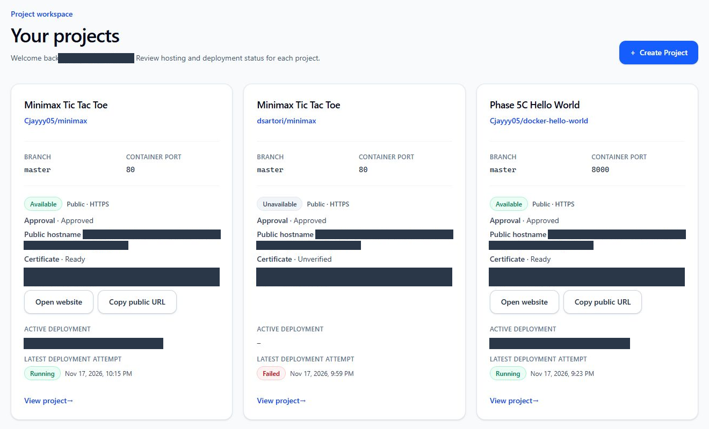
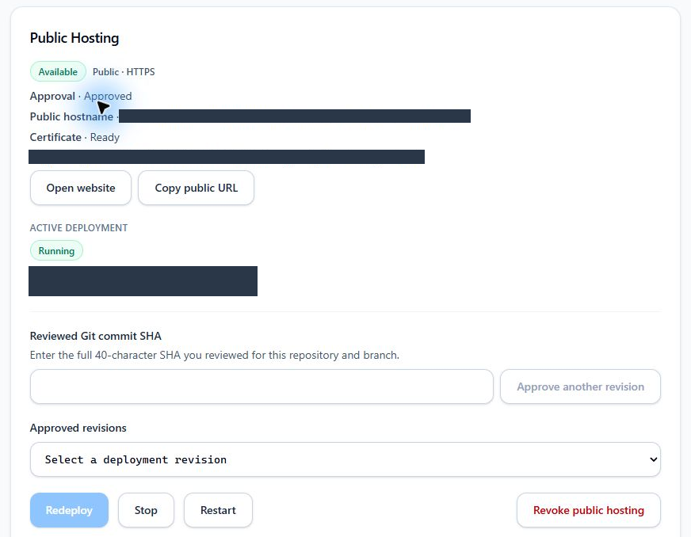
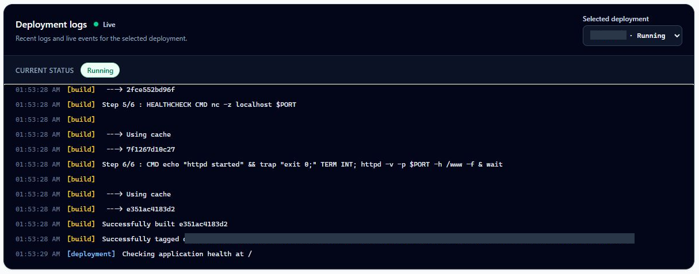
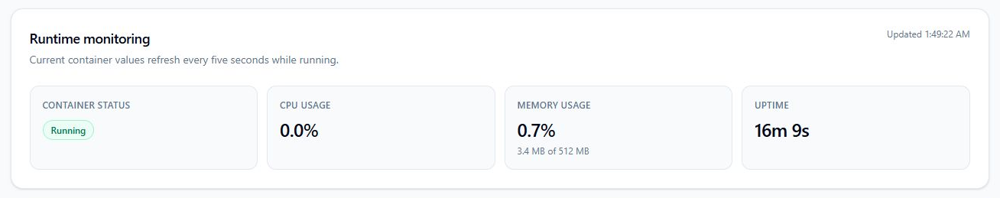
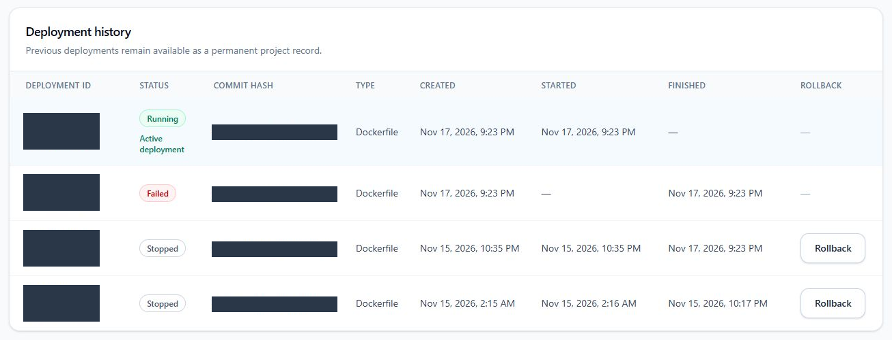
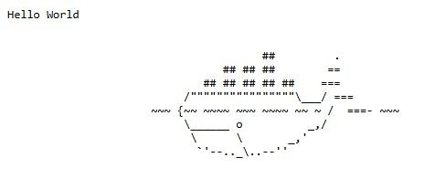
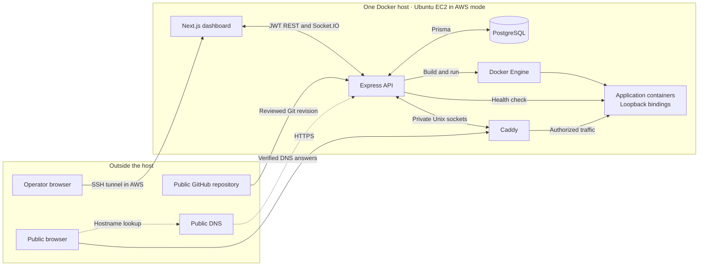

# DeployFlow

DeployFlow is a self-hosted platform that turns trusted public GitHub repositories into Dockerized web applications. I built it to practice the full deployment lifecycle, from cloning and building a repository to publishing a healthy release over HTTPS and recovering from a failed replacement.

The AWS demonstration ran **Hello World** and **Minimax Tic Tac Toe** simultaneously on one Ubuntu EC2 instance, each with a stable URL and a Caddy-managed TLS certificate. The final application release to pass production acceptance was [`0ade47c`](https://github.com/Cjayyy05/Self-Hosted-Deployment-Platform/commit/0ade47c950f5097abf5c6274bf21a3564c960042). The demo websites may be offline when the EC2 instance is stopped.

## Screenshots

These captures show a previous acceptance session. The dashboard shows two live HTTPS applications and a separate failed deployment attempt. The operator views have been cropped and redacted for publication.



<details>
<summary>Public Hosting, deployment logs, monitoring, and history</summary>

**Public Hosting** shows AWS approval, certificate status, and lifecycle controls.



**Deployment logs** show real Docker build output from a disposable local Hello World deployment.



**Runtime monitoring** samples the running AWS container's CPU, memory usage and limit, and uptime.



**Deployment history** shows the active release, previous attempts, and available rollback actions.



</details>

Both AWS demo applications were captured from their public HTTPS pages.

| Hello World | Minimax Tic Tac Toe |
| --- | --- |
|  |  |

## What it does

- Manage several GitHub applications from an authenticated dashboard. See the active deployment and the latest attempt independently.
- Build from a root Dockerfile or generate a temporary one for supported npm, Flask, FastAPI, and Streamlit layouts. DeployFlow records the resolved Git commit.
- Stream deployment progress and Docker build output over Socket.IO. Inspect recent container logs, CPU usage, memory usage and limit, uptime, and deployment history.
- Stop, restart, redeploy, or roll back. A healthy active release stays in service during replacement. Rollback creates a new history entry using the saved image or exact commit.
- Delete a project from **Danger Zone** by typing its exact name. Successful deletion withdraws its hosting route and removes its deployment history, containers, and project-specific image tags. The source on GitHub stays intact.
- Publish approved revisions to separate HTTPS hostnames in AWS mode. Local/private mode also supports signed GitHub push webhooks for automatic replacement deployments.

## Architecture



PostgreSQL records deployment history, revision approvals, and routing state. The API updates Caddy routes over a private admin socket. Caddy checks ingress authorization through a separate socket before forwarding traffic to a container.

## Local mode and AWS mode

| | Local / private | Public AWS hosting |
| --- | --- | --- |
| Management | Loopback dashboard and API with project ownership checks | Private dashboard and API through SSH forwarding, restricted to a configured operator |
| Release selection | Configured branch tip for deploy/redeploy. Optional HMAC-verified, deduplicated GitHub push webhooks | Operator reviews and approves a full Git SHA. Deploy/redeploy use the selected approved SHA |
| Serving traffic | Docker-assigned loopback port or optional stable Caddy HTTP hostname | Stable per-project hostname, automatic TLS, and HTTP-to-HTTPS redirect through Caddy |

## GitHub to public HTTPS

1. Create a project with its public GitHub repository, branch, container port, and health-check path.
2. Review the exact commit. In **Public Hosting**, approve its full SHA, select it, and deploy.
3. The backend fetches and verifies that revision, builds an image with Docker, starts a container on a dedicated loopback binding, and checks application health.
4. DeployFlow checks DNS and configures an exact-host Caddy route. Caddy obtains the certificate and authorizes ingress through a private socket. DeployFlow verifies trusted HTTPS to the candidate before marking it active and retiring the previous container.
5. Once the dashboard verifies the route from the operator's browser, **Open website** and **Copy public URL** become available.

See the [deployment walkthrough](docs/public-deployment.md) for prerequisites, failure behavior, and verification.

## Run locally

Use Node.js 22, npm, Git, Docker, and PostgreSQL. Copy [the backend environment example](backend/.env.example) to `backend/.env`, set `DATABASE_URL` for a local database, and generate an independent random `JWT_SECRET` of at least 32 bytes. Generate a separate webhook key if using auto-deploy.

```sh
# Terminal 1, from the repository root
cd backend
npm ci
npm run prisma:migrate:deploy
npm run dev
```

```sh
# Terminal 2, from the repository root
cd frontend
npm ci
npm run dev -- --hostname 127.0.0.1
```

Open [the local dashboard](http://localhost:3000). Temporarily enable `REGISTRATION_ENABLED` and restart the backend to create the first local account, then disable registration again and restart. For stable local URLs, use the [local Caddy guide](docs/local-hosting.md).

## Stack and testing

| Area | Tools |
| --- | --- |
| Web | Next.js App Router, React, TypeScript, Tailwind CSS |
| API and state | Node.js, Express, Socket.IO, Prisma, PostgreSQL |
| Hosting | Git, Docker Engine and Dockerode, Caddy, Ubuntu/systemd, AWS EC2, dynv6 |
| Quality | ESLint, strict TypeScript, Vitest, Supertest, Playwright, GitHub Actions |

GitHub Actions checks Prisma, lint, types, and builds for the relevant packages, runs backend tests, and verifies public hosting on disposable Linux with Docker, Caddy, and PostgreSQL. The separate Playwright suite includes dashboard flows, DNS status feedback, and typed confirmation and error handling for project deletion. See the [CI workflow](.github/workflows/ci.yml) and [browser test setup](frontend/README.md#dashboard-acceptance-tests).

## Engineering decisions

- **Failed replacements.** Health-check the candidate and verify its proxy route before retiring the active container. Persist unfinished routing operations in PostgreSQL so reconciliation can resolve an interrupted cutover.
- **DNS during publication and monitoring.** Retry transient or missing DNS answers up to six checks during publication without rebuilding the candidate. For a running app, retry a transient resolver error and briefly show **Verifying DNS** when a recent check passed and the route and HTTPS checks still pass. Persistent transient errors show **DNS unverified** and disable the website actions until verification succeeds. Incompatible addresses fail verification immediately.
- **Independent applications.** Give each project a stable hostname and serialize its lifecycle changes with a database-backed lease. Recovery and withdrawal use persisted deployment and routing state.

## Security and limits

DeployFlow is a single-host portfolio project for workloads the operator trusts. REST and Socket.IO enforce access controls. In AWS mode, the management services stay private, public ingress is denied by default, and recorded SHA approvals govern workload admission. Public workloads have resource and network restrictions, and privileged Docker and Caddy administration stays local.

- Deploy only reviewed repositories. Docker daemon access is privileged, and container restrictions are insufficient for arbitrary untrusted code or unrestricted multi-tenant hosting.
- The platform supports public GitHub repositories, one host, and platform-assigned hostnames. Private repositories, per-project custom domains, autoscaling, and high availability are outside scope.
- Build-event replay is bounded and held in memory. Docker log retrieval is limited, and runtime metrics are current samples with no historical charts.

See the [documentation index](docs/README.md), [product specification](SPEC.md), and [three-minute demo script](docs/demo-script.md).
